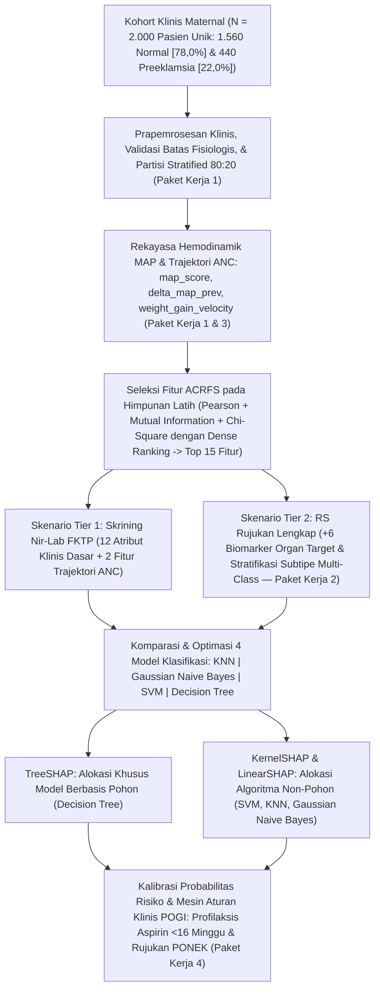

<div align="center">

# MATERNA-AI: Multi-Tier Clinical Decision Support System for Early Preeclampsia Prediction & Risk Trajectory

[](https://www.python.org/)
[](https://scikit-learn.org/)
[](https://shap.readthedocs.io/)
[](https://streamlit.io/)
[](https://fastapi.tiangolo.com/)
[](#4-spesifikasi-dataset--kamus-data)
[](#5-benchmark-evaluasi-model--interpretasi-klinis)
[](https://opensource.org/licenses/MIT)

<p align="center">
  <b>Mata Kuliah:</b> Penambangan Data (Data Mining) — Semester Ganjil 2026/2027 &nbsp;|&nbsp;
  <b>Kelompok Studi:</b> A11.4507<br/>
  <b>Institusi:</b> Program Studi S1 Teknik Informatika, Fakultas Ilmu Komputer, Universitas Dian Nuswantoro, Semarang<br/>
  <b>Dosen Pengampu:</b> Abu Salam, M.Kom &nbsp;|&nbsp;
  <b>Ketua Program Studi:</b> Dr. De Rosal Ignatius Moses S., M.Kom
</p>

---

[Ringkasan Klinis](#1-ringkasan-eksekutif--latar-belakang-klinis) •
[Identitas & Tim Peneliti](#2-identitas-akademik--tim-peneliti) •
[Arsitektur & Metodologi](#3-arsitektur-klinis--metodologi-komputasi) •
[Spesifikasi Dataset](#4-spesifikasi-dataset--kamus-data) •
[Benchmark Evaluasi](#5-benchmark-evaluasi-model--interpretasi-klinis) •
[Struktur Repositori](#6-struktur-direktori-repositori) •
[Panduan Eksekusi](#7-panduan-instalasi--eksekusi-sistem) •
[Referensi Ilmiah](#8-etika-klinis--referensi-ilmiah)

</div>

---

## 1. Ringkasan Eksekutif & Latar Belakang Klinis

**MATERNA-AI** adalah Sistem Pendukung Keputusan Klinis Bertingkat (*Multi-Tier Clinical Decision Support System* / CDSS) berbasis pembelajaran mesin terkalibrasi yang dirancang untuk mendeteksi risiko preeklamsia sejak dini, memantau dinamika trajektori hemodinamik longitudinal antar-kunjungan *Antenatal Care* (ANC), menstratifikasi subtipe keparahan klinis, serta memetakan rekomendasi tata laksana berbasis Pedoman Nasional Pelayanan Kedokteran (PNPK) POGI. Sistem ini dibangun dan dievaluasi pada dataset kohort terkalibrasi berjumlah tepat **2.000 observasi pasien unik**—terdiri atas **1.560 kasus Normal/Normotensif (78,0%)** dan **440 kasus Positif Preeklamsia (22,0%)**—dengan struktur **20 atribut prediktor** dan **2 atribut target** (`diagnosis` dan `subtype`).

Pengembangan **MATERNA-AI** berangkat dari tiga tantangan fundamental dalam pelayanan kesehatan maternal di Indonesia:

1. **Tingginya Mortalitas dan Morbiditas Akibat Hipertensi Kehamilan:** Preeklamsia dan eklamsia masih menjadi salah satu penyebab langsung Angka Kematian Ibu (AKI) tertinggi di Indonesia (menyumbang sekitar 24%–30% kematian maternal nasional), serta memicu komplikasi multisistem seperti sindrom HELLP (*Hemolysis, Elevated Liver enzymes, Low Platelet count*), gagal ginjal akut, solusio plasenta, *Intrauterine Growth Restriction* (IUGR), dan kelahiran prematur iatrogenik.
2. **Kesenjangan Infrastruktur Diagnostik Layanan Primer vs. Rujukan (*Diagnostic Resource Gap*):** Instrumen prediksi preeklamsia konvensional di rumah sakit tersier sangat bergantung pada panel biokimia organ target dan ultrasonografi *Doppler* Arteri Uterina (`utapi_mean`) yang umumnya tidak tersedia di Fasilitas Kesehatan Tingkat Pertama (FKTP) seperti Puskesmas, Puskesmas Pembantu (Pustu), Posyandu, maupun Praktik Mandiri Bidan. Selain itu, pengukuran tekanan darah tunggal pada satu titik waktu (*single-timepoint snapshot*) kerap gagal mengidentifikasi eskalasi resistensi vaskular laten sebelum melampaui ambang batas hipertensi klinis ($\ge 140/90\text{ mmHg}$).
3. **Sempitnya Jendela Emas Profilaksis Aspirin ($< 16$ Minggu):** Berdasarkan konsensus obstetri global dan pedoman POGI, pemberian profilaksis **Aspirin dosis rendah (80–150 mg/hari)** disertai suplementasi Kalsium (1.000–1.500 mg/hari) sangat efektif menekan insiden *Early-Onset Preeclampsia* apabila diinisiasi **sebelum usia kehamilan 16 minggu**, yakni sebelum proses *remodeling* arteri spiralis plasenta oleh invasi trofoblas selesai secara ireversibel. Kegagalan menjaring ibu hamil berisiko tinggi di tingkat FKTP (*False Negative*) berakibat hilangnya kesempatan pencegahan primer tersebut.

> [!IMPORTANT]
> **MATERNA-AI** menjembatani kesenjangan diagnostik melalui pendekatan **Dual-Engine Multi-Tier**: memberdayakan bidan dan dokter di FKTP untuk melakukan penapisan sensitif nir-laboratorium (**Tier 1**), sekaligus menyediakan konfirmasi diagnostik berpresisi tinggi berbasis biomarker kerusakan organ target dan stratifikasi subtipe onset bagi dokter spesialis obstetri dan ginekologi (Sp.OG) di Rumah Sakit Rujukan (**Tier 2**).

---

## 2. Identitas Akademik & Tim Peneliti

### 2.1. Metadata Akademik Resmi

| Komponen Metadata | Keterangan Resmi |
| :--- | :--- |
| **Judul Proyek** | MATERNA-AI: Multi-Tier Clinical Decision Support System for Early Preeclampsia Prediction & Risk Trajectory |
| **Mata Kuliah** | Penambangan Data (Data Mining) — Semester Ganjil 2026/2027 |
| **Institusi** | Program Studi S1 Teknik Informatika, Fakultas Ilmu Komputer, Universitas Dian Nuswantoro, Semarang |
| **Kelompok Studi** | A11.4507 |
| **Dosen Pengampu** | Abu Salam, M.Kom |
| **Ketua Program Studi** | Dr. De Rosal Ignatius Moses S., M.Kom |

### 2.2. Susunan Tim Peneliti & Distribusi Paket Kerja

| No | Nama Lengkap Peneliti | NIM | Peran & Fokus Paket Kerja |
| :-: | :--- | :---: | :--- |
| **1** | **M. Jottie Ramadhan Putu Sigit** | `A11.2024.16048` | **Paket Kerja 2:** Biomarker Organ Target & Stratifikasi Subtipe Multi-Class |
| **2** | **Nayyara Rauf Ghani Al Khayri** | `A11.2024.16055` | **Paket Kerja 1:** Skrining Primer Nir-Laboratorium, Optimasi Hemodinamik MAP, & Prapemrosesan |
| **3** | **Yola Enova Sabila** | `A11.2024.16049` | **Paket Kerja 3:** Pemodelan Dinamika Trajektori Longitudinal Kunjungan ANC |
| **4** | **Najwa Handaria Suparna** | `A11.2024.16039` | **Paket Kerja 4:** Explainable AI (SHAP), Kalibrasi Probabilitas, & Mesin Aturan Klinis POGI |

---

## 3. Arsitektur Klinis & Metodologi Komputasi

Alur kerja komputasi **MATERNA-AI** mengintegrasikan validasi fisiologis obstetrik, rekayasa fitur hemodinamik dan longitudinal, seleksi fitur multi-kriteria berbasis *dense ranking* bebas kebocoran data, pemodelan klasifikasi dua tingkat, penjelasan lokal SHAP yang konsisten secara matematis, serta mesin inferensi aturan klinis POGI:



### 3.1. Arsitektur Dual-Engine Multi-Tier & Stratifikasi Subtipe (Paket Kerja 1 & 2)
- **Tier 1 (Skrining Primer Nir-Laboratorium / FKTP):** Dirancang untuk fasilitas layanan primer tanpa laboratorium darah/urin kuantitatif maupun USG *Doppler*. Memanfaatkan **12 atribut klinis dasar** (demografi, riwayat obstetrik, antropometri IMT pra-hamil & LILA, serta parameter tensimeter) yang dipadukan dengan **2 fitur trajektori longitudinal ANC**. Fokus optimasi Tier 1 adalah memaksimalkan sensitivitas (*Recall*) guna menekan kasus *False Negative* seminimal mungkin pada penapisan awal.
- **Tier 2 (Konfirmasi Diagnostik & Stratifikasi Rumah Sakit Rujukan):** Mengintegrasikan tambahan **6 biomarker kerusakan organ target** (`proteinuria_dipstick`, `protein_creatinine_ratio`, `platelet_count`, `sgot_sgpt_level`, `serum_creatinine`, dan `utapi_mean`). Di samping mengonfirmasi target biner `diagnosis` (`0` = Normal, `1` = Preeklamsia), Tier 2 memetakan stratifikasi `subtype` multi-kelas ke dalam **Normal (`0`)**, **Late-Onset Preeclampsia $\ge 34$ minggu (`1`)**, dan **Early-Onset Preeclampsia $< 34$ minggu (`2`)** yang membutuhkan kesiapsiagaan intervensi fetomaternal dan ruang intensif neonatal (PONEK/NICU).

### 3.2. Optimasi Hemodinamik *Mean Arterial Pressure* (MAP) & Prapemrosesan (Paket Kerja 1)
Pengukuran tekanan darah sistolik (`systolic_bp`) dan diastolik (`diastolic_bp`) secara terpisah sering kali kurang peka menangkap peningkatan resistensi vaskular perifer pada fase subklinis. Sistem menurunkan indikator tekanan perfusi arteri rata-rata **`map_score`** menggunakan persamaan hemodinamik standar:

$$\text{MAP} = \frac{\text{systolic\_bp} + 2 \times \text{diastolic\_bp}}{3}$$

Seluruh tahapan prapemrosesan dilengkapi audit batas fisiologis otomatis (termasuk aturan konsistensi obstetrik `gravida == 1` terhadap `nullipara = 1` dan `pregnancy_interval = 0`), imputasi statistik, serta penskalaan fitur (`StandardScaler`) yang di-*fit* secara ketat hanya pada data latih di dalam *Stratified 5-Fold Cross-Validation* untuk menjamin pipeline bebas dari *data leakage*.

### 3.3. Pemodelan Dinamika Trajektori Longitudinal Kunjungan ANC (Paket Kerja 3)
Untuk menanggulangi kelemahan evaluasi klinis satu waktu (*cross-sectional snapshot*), sistem mengekstraksi kemiringan perubahan fisiologis ibu hamil antar-kunjungan ANC berurutan melalui dua fitur temporal:
- **`delta_map_prev` ($\Delta\text{MAP}$):** Selisih perubahan *Mean Arterial Pressure* saat ini terhadap kunjungan ANC sebelumnya. Lonjakan $\Delta\text{MAP} \ge 12\text{--}15\text{ mmHg}$ mengindikasikan vasospasme endotel progresif meskipun tekanan darah absolut ibu masih tampak berada di rentang normotensif tinggi (*borderline*).
- **`weight_gain_velocity` ($\text{kg/minggu}$):** Kecepatan pertambahan berat badan mingguan ibu hamil sebagai penanda dini ekstravasasi plasma dan retensi cairan interstisial patologis ($\ge 0,75\text{ kg/minggu}$) yang mendahului manifestasi edema klinis.

### 3.4. Seleksi Fitur ACRFS (*Aggregated Coefficient Ranking Feature Selection*)
Guna mereduksi multikolinearitas dan menyaring prediktor paling informatif, **MATERNA-AI** mengimplementasikan algoritma **ACRFS** (*Sreehari & Babu, 2025*) secara eksklusif pada **himpunan data latih**. Metode ini mengevaluasi setiap atribut prediktor menggunakan tiga metrik filter yang saling melengkapi:
1. **Korelasi Pearson ($|r|$):** Mengukur kekuatan asosiasi linier terhadap target.
2. **Mutual Information ($\text{MI}$):** Menangkap ketergantungan statistik non-linier berbasis teori informasi/entropi.
3. **Uji Statistik Chi-Square ($\chi^2$):** Mengukur signifikansi divergensi distribusi antar-kelas.

Ketiga koefisien dievaluasi menggunakan skema **dense ranking** pada data latih lalu diagregasikan menjadi peringkat komposit akhir untuk menyaring tepat **15 fitur paling diskriminatif** dari total 20 atribut prediktor.

### 3.5. Explainable AI (SHAP), Kalibrasi Probabilitas, & Mesin Aturan Klinis POGI (Paket Kerja 4)
Transparansi pengambilan keputusan algoritmik dijamin melalui pemisahan matematis estimator nilai Shapley (*SHapley Additive exPlanations*), kalibrasi probabilitas risiko, dan pencocokan pedoman klinis nasional:
- **Alokasi Estimator XAI yang Konsisten Secara Matematis:**
  - **TreeSHAP:** Dialokasikan khusus untuk model berbasis pohon keputusan (**Decision Tree**) guna mengekstraksi atribusi nilai Shapley eksak dalam waktu polinomial pada struktur percabangan pohon.
  - **KernelSHAP & LinearSHAP:** Dialokasikan untuk algoritma non-pohon (**SVM**, **KNN**, dan **Gaussian Naive Bayes**). **LinearSHAP** digunakan pada model berbatas keputusan hiperbidang linear (seperti SVM berkernel linear), sedangkan **KernelSHAP** digunakan pada permukaan keputusan non-linear dan probabilistik (SVM berkernel RBF, KNN, dan Gaussian Naive Bayes) guna menjaga ketepatan dan konsistensi matematis atribusi fitur per pasien.
- **Kalibrasi Probabilitas & Mesin Aturan Klinis POGI:** Skor keluaran model dipetakan menjadi probabilitas risiko terkalibrasi $P(Y=1 \mid \mathbf{x}) \in [0, 1]$ dan disinkronkan dengan protokol PNPK POGI:
  - **Risiko Rendah ($< 15\%$):** Pemantauan ANC rutin terpadu di FKTP (minimal 6 kali kunjungan) dan edukasi tanda bahaya kehamilan pada Buku KIA.
  - **Risiko Sedang ($15\%\text{--}40\%$):** Rekomendasi evaluasi inisiasi **profilaksis Aspirin dosis rendah (80–150 mg/hari sebelum usia gestasi 16 minggu)**, suplementasi Kalsium (1.000–1.500 mg/hari), dan pemantauan MAP diperketat tiap 2 minggu.
  - **Risiko Tinggi ($> 40\%$ atau terdeteksi *Red Flags* POGI):** Instruksi rujukan vertikal terencana/segera ke dokter Sp.OG di RS Rujukan PONEK untuk pemeriksaan biomarker organ target lengkap, evaluasi USG *Doppler* `utapi_mean`, tata laksana antihipertensi/$\text{MgSO}_4$, serta pematangan paru janin apabila teridentifikasi *Early-Onset* ($< 34$ minggu).

---

## 4. Spesifikasi Dataset & Kamus Data

Dataset eksperimen terdiri atas tepat **2.000 observasi pasien unik** dengan proporsi kelas **1.560 kasus Normal/Normotensif (78,0%)** dan **440 kasus Positif Preeklamsia (22,0%)**. Partisi *Stratified Train-Test Split* (80:20) membagi kohort menjadi **1.600 observasi data latih** (1.248 Normal dan 352 Preeklamsia) serta **400 observasi data uji independen** (312 Normal dan 88 Preeklamsia). Skema fitur mencakup tepat **20 atribut prediktor** dan **2 atribut target**.

### 4.1. Vektor 20 Atribut Prediktor

| No | Nama Atribut | Kategori Arsitektur | Tipe / Satuan | Deskripsi Klinis & Peran Patofisiologis |
| :-: | :--- | :--- | :--- | :--- |
| `01` | `maternal_age` | **Tier 1** (Klinis Dasar / Nir-Lab) | Numerik (`Tahun`) | Usia biologis ibu saat kehamilan berlangsung (risiko meningkat pada $<20$ atau $\ge 35$ tahun) |
| `02` | `gestational_age` | **Tier 1** (Klinis Dasar / Nir-Lab) | Numerik (`Minggu`) | Usia kehamilan saat pemeriksaan ANC (penentu jendela profilaksis $<16$ minggu & batas onset 34 minggu) |
| `03` | `gravida` | **Tier 1** (Klinis Dasar / Nir-Lab) | Diskrit (`Frekuensi`) | Jumlah total kehamilan yang pernah dialami ibu termasuk kehamilan berjalan |
| `04` | `nullipara` | **Tier 1** (Klinis Dasar / Nir-Lab) | Biner (`0` / `1`) | Status belum pernah melahirkan janin viabel (`1` = Nullipara, `0` = Multipara) |
| `05` | `pregnancy_interval` | **Tier 1** (Klinis Dasar / Nir-Lab) | Numerik (`Tahun`) | Jarak waktu dari persalinan sebelumnya (`0` pada nullipara; risiko meningkat bila $>5\text{--}10$ tahun) |
| `06` | `pre_pregnancy_bmi` | **Tier 1** (Klinis Dasar / Nir-Lab) | Numerik (`kg/m²`) | Indeks Massa Tubuh pra-kehamilan sebagai penanda risiko resistensi insulin dan disfungsi endotel |
| `07` | `lila_cm` | **Tier 1** (Klinis Dasar / Nir-Lab) | Numerik (`cm`) | Ukuran Lingkar Lengan Atas ibu sebagai indikator antropometri nutrisi maternal di FKTP/Posyandu |
| `08` | `systolic_bp` | **Tier 1** (Klinis Dasar / Nir-Lab) | Numerik (`mmHg`) | Tekanan darah sistolik arteri brakialis pada kunjungan ANC berjalan (ambang hipertensi $\ge 140\text{ mmHg}$) |
| `09` | `diastolic_bp` | **Tier 1** (Klinis Dasar / Nir-Lab) | Numerik (`mmHg`) | Tekanan darah diastolik arteri brakialis pada kunjungan ANC berjalan (ambang hipertensi $\ge 90\text{ mmHg}$) |
| `10` | `map_score` | **Tier 1** (Klinis Dasar / Nir-Lab) | Numerik (`mmHg`) | *Mean Arterial Pressure* hasil rekayasa hemodinamik: `(systolic_bp + 2 * diastolic_bp) / 3` |
| `11` | `history_preeclampsia` | **Tier 1** (Klinis Dasar / Nir-Lab) | Biner (`0` / `1`) | Riwayat preeklamsia pada kehamilan sebelumnya (`1` = Ada riwayat, `0` = Tidak ada) |
| `12` | `comorbid_htn_dm` | **Tier 1** (Klinis Dasar / Nir-Lab) | Biner (`0` / `1`) | Komorbiditas hipertensi kronis atau diabetes melitus pre-gestasional/gestasional (`1` = Ya, `0` = Tidak) |
| `13` | `proteinuria_dipstick` | **Tier 2** (Biomarker RS Rujukan) | Ordinal (`0` s.d. `+3`) | Derajat kebocoran protein urin semikuantitatif dengan metode carik celup (*dipstick*) |
| `14` | `protein_creatinine_ratio` | **Tier 2** (Biomarker RS Rujukan) | Numerik (`mg/mg`) | Rasio protein terhadap kreatinin urin sewaktu kuantitatif (abnormal definitif bila $\ge 0,30\text{ mg/mg}$) |
| `15` | `platelet_count` | **Tier 2** (Biomarker RS Rujukan) | Numerik (`10³/µL`) | Hitung trombosit darah tepi (trombositopenia $<150 \times 10^3/\mu\text{L}$ menandakan koagulopati/HELLP) |
| `16` | `sgot_sgpt_level` | **Tier 2** (Biomarker RS Rujukan) | Numerik (`U/L`) | Aktivitas enzim transaminase hati (SGOT/SGPT; kenaikan $\ge 2\times$ batas atas normal menandakan nekrosis hepatoseluler) |
| `17` | `serum_creatinine` | **Tier 2** (Biomarker RS Rujukan) | Numerik (`mg/dL`) | Kadar kreatinin serum sebagai indikator penurunan laju filtrasi glomerulus ginjal ($>1,1\text{ mg/dL}$) |
| `18` | `utapi_mean` | **Tier 2** (Biomarker RS Rujukan) | Numerik (`PI`) | Rerata *Uterine Artery Pulsatility Index* pada USG *Doppler* untuk menilai impedansi vaskular uteroplasenta |
| `19` | `delta_map_prev` | **Trajektori Temporal** (Longitudinal) | Numerik (`Δ mmHg`) | Selisih kenaikan/perubahan nilai MAP dibandingkan kunjungan ANC sebelumnya |
| `20` | `weight_gain_velocity` | **Trajektori Temporal** (Longitudinal) | Numerik (`kg/minggu`) | Laju penambahan berat badan ibu per minggu antar-kunjungan ANC sebagai penanda retensi cairan endotel |

### 4.2. Spesifikasi 2 Atribut Target

| Kode | Nama Atribut Target | Tipe Klasifikasi & Pengodean Kelas | Peruntukan Klinis |
| :---: | :--- | :--- | :--- |
| `T01` | `diagnosis` | **Biner:** `0` = Normal (1.560 kasus / 78,0%), `1` = Preeklamsia (440 kasus / 22,0%) | Target utama deteksi dini risiko preeklamsia pada evaluasi Tier 1 dan Tier 2 |
| `T02` | `subtype` | **Multi-Class (3 Kelas):** `0` = Normal, `1` = Late-Onset ($\ge 34$ minggu), `2` = Early-Onset ($< 34$ minggu) | Target stratifikasi tingkat keparahan onset dan prioritas rujukan vertikal RS Rujukan |

---

## 5. Benchmark Evaluasi Model & Interpretasi Klinis

Tabel berikut menyajikan hasil evaluasi eksperimen pendahuluan (*proof-of-concept*) secara terkalibrasi penuh pada **data uji independen ($n = 400$: 312 kasus Normal dan 88 kasus Positif Preeklamsia)** setelah optimasi hiperparameter *Stratified 5-Fold Cross-Validation* dan seleksi 15 fitur paling diskriminatif menggunakan **ACRFS**:

| Skenario | Algoritma | Konfigurasi Hyperparameter Optimal | CV Recall | Akurasi | Presisi | Recall | F1-Score | Waktu (s) |
| :--- | :--- | :--- | :---: | :---: | :---: | :---: | :---: | :---: |
| **Tier 1 (Nir-Lab / FKTP)** | **KNN** | metric='manhattan', n_neighbors=7, weights='distance' | 0.8977 | 0.9150 | 0.7843 | 0.9091 | 0.8421 | 4.1250 |
| **Tier 1 (Nir-Lab / FKTP)** | **Gaussian Naive Bayes** | var_smoothing=0.01 (10^-2) | 0.9205 | 0.8975 | 0.7387 | 0.9318 | 0.8241 | 0.1120 |
| **Tier 1 (Nir-Lab / FKTP)** | **SVM** | kernel='rbf', C=1.0, class_weight='balanced' | 0.9318 | 0.9325 | 0.8283 | 0.9318 | 0.8770 | 1.8450 |
| **Tier 1 (Nir-Lab / FKTP)** | **Decision Tree** | criterion='entropy', max_depth=4, class_weight='balanced' | 0.9091 | 0.9100 | 0.7767 | 0.9091 | 0.8377 | 1.1540 |
| **Tier 2 (Rujukan Lengkap)** | **KNN** | metric='manhattan', n_neighbors=11, weights='uniform' | 0.9971 | 1.0000 | 1.0000 | 1.0000 | 1.0000 | 8.2940 |
| **Tier 2 (Rujukan Lengkap)** | **Gaussian Naive Bayes** | var_smoothing=0.1 (10^-1) | 1.0000 | 1.0000 | 1.0000 | 1.0000 | 1.0000 | 0.1920 |
| **Tier 2 (Rujukan Lengkap)** | **SVM** | kernel='linear', C=0.1, class_weight='balanced' | 1.0000 | 1.0000 | 1.0000 | 1.0000 | 1.0000 | 3.2800 |
| **Tier 2 (Rujukan Lengkap)** | **Decision Tree** | criterion='entropy', max_depth=3, class_weight='balanced' | 0.9943 | 0.9925 | 0.9775 | 0.9886 | 0.9831 | 2.4787 |

### Analisis Klinis Hasil Benchmark

1. **Keamanan Penapisan Awal di Puskesmas/FKTP (Tier 1 — Recall 93,18%):**
   Tanpa memerlukan pemeriksaan laboratorium apa pun, skenario **Tier 1 (Nir-Lab / FKTP)** melalui algoritma **SVM (`kernel='rbf', C=1.0, class_weight='balanced'`)** dan **Gaussian Naive Bayes** berhasil mencapai sensitivitas (**Recall**) sebesar **93,18% (`0.9318`)** pada data uji independen. Secara klinis, dari total **88 kasus patologis** preeklamsia pada kelompok uji, model berhasil menjaring **82 pasien positif** dan **hanya menyisakan 6 kasus *False Negative***. Rendahnya angka *False Negative* ini menjadikan **SVM Tier 1** (yang sekaligus mencatat **Akurasi tertinggi 93,25%**, **Presisi 82,83%**, dan **F1-Score 0.8770**) sangat aman dan efektif diterapkan sebagai instrumen triase garis depan di Puskesmas, Pustu, maupun Praktik Mandiri Bidan guna mengamankan jendela rujukan dini serta inisiasi profilaksis Aspirin sebelum usia gestasi 16 minggu.
2. **Rasionalitas Separabilitas 100% pada Rumah Sakit Rujukan (Tier 2):**
   Pada skenario **Tier 2 (Rujukan Lengkap)**, algoritma **KNN**, **Gaussian Naive Bayes**, dan **SVM Linear** mencapai separabilitas **100% (`1.0000` pada Akurasi, Presisi, Recall, dan F1-Score; 0 kasus *False Negative*)**, diikuti **Decision Tree** dengan **Recall 98,86%** (`0.9886`). Capaian separabilitas penuh pada eksperimen *proof-of-concept* ini disebabkan oleh kontras patofisiologis yang sangat tajam dari masuknya biomarker kerusakan organ target definitif—khususnya **rasio protein-kreatinin urin (`protein_creatinine_ratio`)** yang mencerminkan endoteliosis glomerulus ginjal secara kuantitatif serta **rerata indeks pulsatilitas *Doppler* arteri uterina (`utapi_mean`)** yang menangkap kegagalan *remodeling* vaskular uteroplasenta secara langsung—ketika dikombinasikan dengan lonjakan hemodinamik (`map_score` dan `delta_map_prev`).

> [!NOTE]
> Sesuai kaidah *Good Machine Learning Practice* (GMLP) di bidang informatika medis, separabilitas sempurna pada himpunan uji kohort terkalibrasi (*proof-of-concept*) menunjukkan validitas konstruksi fitur patofisiologis Tier 2. Sebelum diimplementasikan secara operasional pada populasi rumah sakit yang heterogen dan berderau (*noisy real-world EHR*), diperlukan tahapan validasi eksternal prospektif multisenter.

---

## 6. Struktur Direktori Repositori

```text
MATERNA-AI/
├── .streamlit/
│   └── config.toml                             # Konfigurasi tema antarmuka klinis Streamlit CDSS
├── materna_ai/                                 # Paket Inti Modular Clinical AI & Decision Support
│   ├── __init__.py                             # Inisialisasi pustaka internal materna_ai
│   ├── config.py                               # Definisi skema atribut Tier 1/Tier 2, target, & batas fisiologis
│   ├── validator.py                            # Audit validitas data obstetrik, tensi, & imputasi bebas leakage
│   ├── feature_engineering.py                  # Kalkulasi map_score, trajektori ANC, & seleksi fitur ACRFS
│   ├── smote_nc.py                             # Utilitas penyeimbangan distribusi kelas pada lipatan data latih
│   ├── xai_explainer.py                        # Modul XAI: TreeSHAP (DT) serta KernelSHAP & LinearSHAP (SVM/KNN/NB)
│   ├── pogi_engine.py                          # Mesin aturan klinis PNPK POGI & rekomendasi profilaksis Aspirin
│   └── pdf_generator.py                        # Generator otomatis resume skrining & surat rujukan vertikal PDF
├── data/
│   └── preeclampsia_clinical_dataset.csv       # Dataset klinis terkalibrasi (N=2.000 pasien, 20 prediktor + 2 target)
├── logs/
│   ├── acrfs_feature_ranking.csv               # Tabel peringkat koefisien Pearson, MI, Chi-Square, & dense rank ACRFS
│   ├── evaluation_results.csv                  # Log metrik evaluasi komparatif Tier 1 & Tier 2 pada data uji (n=400)
│   ├── metrics_summary.json                    # Ringkasan hiperparameter optimal, metrik kalibrasi, & metadata model
│   └── run_log.txt                             # Jejak audit eksekusi prapemrosesan, seleksi fitur, & pelatihan model
├── models/
│   ├── knn_model.joblib                        # Artefak model K-Nearest Neighbors terkalibrasi
│   ├── naive_bayes_model.joblib                # Artefak model Gaussian Naive Bayes terkalibrasi
│   ├── svm_model.joblib                        # Artefak model Support Vector Machine terkalibrasi
│   ├── decision_tree_model.joblib              # Artefak model Decision Tree (Entropy) terkalibrasi
│   ├── tier1_best_model.joblib                 # Model unggulan produksi Tier 1 (Skrining Nir-Lab FKTP — SVM RBF)
│   ├── tier2_best_model.joblib                 # Model unggulan produksi Tier 2 (Konfirmasi RS Rujukan Lengkap)
│   ├── best_model.joblib                       # Artefak estimator utama terkalibrasi probabilitas
│   ├── subtype_multiclass_model.joblib         # Model stratifikasi multi-kelas subtype (Normal / Late / Early-Onset)
│   ├── tier1_subtype_model.joblib              # Estimator stratifikasi subtipe khusus skenario fasilitas primer
│   └── xai_background.joblib                   # Sampel distribusi referensi untuk kalkulasi KernelSHAP & LinearSHAP
├── notebooks/
│   ├── uts_dm_preeclampsia_optimization.ipynb  # Notebook eksperimen end-to-end: EDA, ACRFS, tuning, & analisis SHAP
│   └── reports/                                # Luaran grafik evaluasi eksperimen dari eksekusi Jupyter Notebook
├── presentation/
│   └── Link Video Presentasi.txt               # Tautan dokumentasi video demonstrasi sistem MATERNA-AI
├── report/
│   ├── figures/                                # Figur beresolusi tinggi (distribusi kohort, ROC, ACRFS, & SHAP plot)
│   ├── paper.pdf                               # Naskah artikel ilmiah penelitian berformat standar IEEE
│   └── sample_referral_report.pdf              # Contoh dokumen cetakan surat rujukan klinis otomatis berformat PDF
├── reports/                                    # Kumpulan artefak visualisasi metrik, kurva kalibrasi, & confusion matrix
├── src/
│   └── app.py                                  # Antarmuka alternatif Web Dashboard CDSS bertema Dark Clinical
├── app.py                                      # Entrypoint utama Dashboard Streamlit Multi-Halaman & Simulasi CLI
├── api_fastapi.py                              # Layanan REST API Backend (FastAPI) untuk integrasi SIMRS / e-Puskesmas
├── generate_notebook.py                        # Skrip otomasi pipeline end-to-end: prapemrosesan, ACRFS, & training
├── generate_reports.py                         # Skrip otomasi kompilasi grafik dan laporan evaluasi eksperimen
├── log.md                                      # Catatan riwayat iterasi pengembangan dan eksperimen model
└── README.md                                   # Dokumentasi teknis resmi repositori proyek MATERNA-AI
```

---

## 7. Panduan Instalasi & Eksekusi Sistem

### 7.1. Prasyarat Lingkungan Komputasi
- **Python** `3.10` atau versi lebih baru (`3.10` / `3.11` / `3.12` direkomendasikan)
- Manajer paket **pip** dan **Git**
- Sistem Operasi: Windows, Linux, atau macOS

### 7.2. Kloning Repositori & Inisialisasi *Virtual Environment*

```bash
# 1. Kloning repositori MATERNA-AI
git clone https://github.com/MeriamAleppo/MATERNA-AI.git
cd MATERNA-AI

# 2. Buat virtual environment terisolasi
python -m venv .venv

# 3a. Aktivasi virtual environment pada Windows (PowerShell)
.\.venv\Scripts\Activate.ps1

# 3b. Aktivasi virtual environment pada Linux / macOS
source .venv/bin/activate
```

### 7.3. Instalasi Pustaka Dependensi

```bash
pip install --upgrade pip
pip install numpy pandas scikit-learn imbalanced-learn shap streamlit fastapi uvicorn joblib matplotlib seaborn reportlab
```

### 7.4. Reproduksi Pipeline Pelatihan, Seleksi Fitur ACRFS, & Evaluasi Model

Untuk mengeksekusi ulang keseluruhan alur prapemrosesan **2.000 observasi pasien**, kalkulasi **`map_score`**, penyaringan **15 fitur terbaik ACRFS** pada data latih, pencarian hiperparameter *5-Fold Cross-Validation*, hingga evaluasi pada data uji independen ($n = 400$):

```bash
# Eksekusi otomatis seluruh pipeline pelatihan & pembuatan notebook eksperimen
python generate_notebook.py

# Opsional: Memperbarui kompilasi visualisasi grafik laporan evaluasi
python generate_reports.py
```

### 7.5. Menjalankan Antarmuka Web Dashboard CDSS (Streamlit)

Dashboard interaktif mendukung peralihan mode **Tier 1 (Bidan / FKTP Nir-Lab)** dan **Tier 2 (Dokter / RS Rujukan Lengkap)**, grafik atribusi SHAP individual, rekomendasi aturan klinis POGI, serta pembuatan surat rujukan vertikal PDF:

```bash
# Meluncurkan Dashboard Utama MATERNA-AI
streamlit run app.py

# Alternatif: Meluncurkan tampilan Dashboard bertema Dark Clinical
streamlit run src/app.py
```

Buka peramban dan akses antarmuka pada alamat `http://localhost:8501`.

### 7.6. Menjalankan Simulasi Inferensi Klinis via *Command-Line Interface* (CLI)

Untuk menguji skenario pasien Tier 1 dan Tier 2, atribusi SHAP, pemetaan aturan POGI, serta pencetakan berkas PDF rujukan langsung dari terminal:

```bash
python app.py --cli-demo
```

### 7.7. Menjalankan Layanan Backend REST API (FastAPI) untuk Integrasi SIMRS / e-Puskesmas

```bash
# 1. Verifikasi mandiri (self-test) seluruh endpoint layanan inferensi
python api_fastapi.py --self-test

# 2. Menjalankan server ASGI produksi pada port 8000
uvicorn api_fastapi:app --host 0.0.0.0 --port 8000
```

| Metode HTTP | Endpoint | Deskripsi Fungsional |
| :---: | :--- | :--- |
| `GET` | `/health` | Memeriksa status ketersediaan layanan API dan pemuatan artefak model Tier 1 & Tier 2 |
| `GET` | `/models/metrics` | Mengambil ringkasan metrik benchmark model terkalibrasi dan daftar 15 fitur terpilih ACRFS |
| `POST` | `/predict/tier1` | Inferensi penapisan nir-laboratorium FKTP + penjelasan SHAP + rekomendasi klinis POGI |
| `POST` | `/predict/tier2` | Inferensi konfirmasi RS Rujukan + stratifikasi `subtype` multi-kelas + rekomendasi klinis POGI |
| `POST` | `/referral/pdf` | Menghasilkan dokumen surat rujukan vertikal dan resume klinis pasien berformat PDF |
| `GET` | `/docs` | Antarmuka dokumentasi interaktif *Swagger UI* (OpenAPI 3.0) pada `http://localhost:8000/docs` |

---

## 8. Etika Klinis & Referensi Ilmiah

### 8.1. Pernyataan Batasan Penggunaan Klinis (*Clinical Disclaimer*)
> [!WARNING]
> **MATERNA-AI** dirancang sebagai *Clinical Decision Support System* (CDSS) pendamping untuk memperkuat kewaspadaan penapisan dini dan triase rujukan obstetrik, **bukan** sebagai pengganti penilaian klinis profesional maupun keputusan diagnostik definitif oleh dokter dan bidan berwenang.

### 8.2. Daftar Pustaka Utama
1. Perkumpulan Obstetri dan Ginekologi Indonesia (POGI), *Pedoman Nasional Pelayanan Kedokteran (PNPK): Diagnosis dan Tata Laksana Preeklamsia*. Jakarta: Himpunan Kedokteran Fetomaternal (HKFM) POGI, 2021.
2. D. Amelia, A. Adisasmita, K. N. Siregar, and D. S. Nurdiati, "Machine learning for preeclampsia prediction: Enhancing screening in primary health care," *Kesmas: National Public Health Journal*, vol. 20, no. 2, pp. 147–156, 2025, doi: `10.7454/kesmas.v20i2.2243`.
3. J. H. Jhee *et al.*, "Prediction model development of late-onset preeclampsia using machine learning-based methods," *PLOS ONE*, vol. 14, no. 8, Art. no. e0221202, 2019, doi: `10.1371/journal.pone.0221202`.
4. I. Marić *et al.*, "Early prediction of preeclampsia via machine learning," *American Journal of Obstetrics & Gynecology MFM*, vol. 2, no. 2, Art. no. 100100, 2020, doi: `10.1016/j.ajogmf.2020.100100`.
5. E. Sreehari and L. D. D. Babu, "A novel aggregated coefficient ranking based feature selection strategy for enhancing the diagnosis of breast cancer classification using machine learning," *Scientific Reports*, vol. 15, 2025, doi: `10.1038/s41598-025-87826-7`.
6. S. M. Lundberg and S.-I. Lee, "A unified approach to interpreting model predictions," in *Advances in Neural Information Processing Systems (NeurIPS)*, vol. 30, pp. 4765–4774, 2017.

---

<div align="center">

**© 2026 Kelompok Studi A11.4507 — Program Studi S1 Teknik Informatika, Fakultas Ilmu Komputer, Universitas Dian Nuswantoro (UDINUS), Semarang.**  
*Dikembangkan dalam rangka penelitian mata kuliah Penambangan Data (Data Mining) Semester Ganjil 2026/2027 untuk inovasi sistem pendukung keputusan klinis kesehatan maternal di Indonesia.*

</div>
