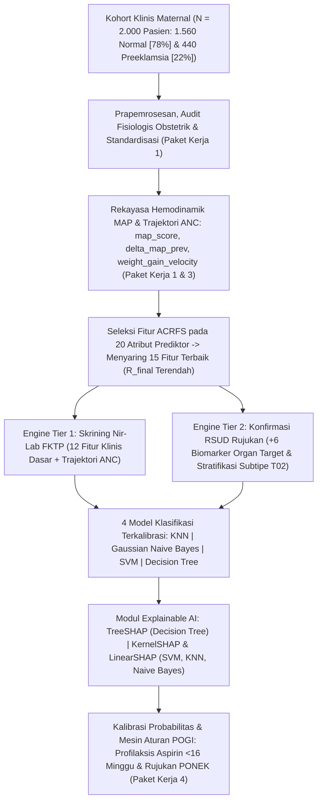

<div align="center">

# MATERNA-AI: Multi-Tier Clinical Decision Support System for Early Preeclampsia Prediction & Risk Trajectory

[](https://www.python.org/)
[](https://streamlit.io/)
[](https://scikit-learn.org/)
[](https://fastapi.tiangolo.com/)
[](https://opensource.org/licenses/MIT)
[](https://github.com/MeriamAleppo/MATERNA-AI)

<p align="center">
  <b>Mata Kuliah:</b> Penambangan Data (Data Mining) — Ganjil 2026/2027 &nbsp;|&nbsp;
  <b>Kelompok Studi:</b> A11.4410<br/>
  <b>Program Studi:</b> S1 Teknik Informatika, Fakultas Ilmu Komputer, Universitas Dian Nuswantoro, Semarang<br/>
  <b>Dosen Pengampu:</b> Ardytha Luthfiarta, M.Kom, MCS
</p>

---

[Ringkasan Eksekutif](#1-ringkasan-eksekutif--latar-belakang-masalah) •
[Tim Peneliti](#2-tim-peneliti--distribusi-paket-kerja) •
[Arsitektur Solusi](#3-arsitektur-solusi-materna-ai) •
[Kamus Data](#4-kamus-data--spesifikasi-20-atribut-prediktor) •
[Benchmark Evaluasi](#5-hasil-eksperimen--benchmark-evaluasi) •
[Struktur Direktori](#6-struktur-direktori-repositori) •
[Instalasi & Eksekusi](#7-panduan-instalasi--eksekusi-cepat) •
[Referensi Ilmiah](#8-sumber-data--referensi-ilmiah)

</div>

---

## 1. Ringkasan Eksekutif & Latar Belakang Masalah

**MATERNA-AI** adalah Sistem Pendukung Keputusan Klinis Bertingkat (*Multi-Tier Clinical Decision Support System* / CDSS) berbasis pembelajaran mesin terkalibrasi yang dirancang untuk melakukan deteksi dini preeklamsia, memantau dinamika trajektori hemodinamik antar-kunjungan *Antenatal Care* (ANC), menstratifikasi subtipe keparahan klinis, serta memetakan rekomendasi intervensi sesuai protokol nasional. Sistem ini dikembangkan dan divalidasi pada kohort terstruktur berjumlah tepat **2.000 observasi pasien unik** (**1.560 kehamilan Normal [78%]** dan **440 kasus Preeklamsia [22%]**) menggunakan **20 atribut prediktor** dan **2 variabel target**.

Pengembangan **MATERNA-AI** dilandasi oleh tiga urgensi klinis utama pada layanan kesehatan maternal di Indonesia:

1. **Tingginya Angka Kematian Ibu (AKI) Akibat Hipertensi Kehamilan di Indonesia:** Preeklamsia dan eklamsia masih menjadi salah satu dari dua penyebab langsung kematian maternal tertinggi di Indonesia (menyumbang sekitar 24%–30% AKI nasional), sekaligus memicu komplikasi multisistem fatal seperti sindrom HELLP (*Hemolysis, Elevated Liver enzymes, Low Platelet count*), gagal ginjal akut, solusio plasenta, pertumbuhan janin terhambat (*Intrauterine Growth Restriction* / IUGR), dan kelahiran prematur iatrogenik.
2. **Kesenjangan Diagnostik antara FKTP dan RS Rujukan (*Diagnostic Resource Gap*):** Model prediksi preeklamsia modern di negara maju umumnya mengandalkan panel biomarker biokimia organ target dan ultrasonografi *Doppler* Arteri Uterina (*UtAPI*) yang hanya tersedia di Rumah Sakit Umum Daerah (RSUD) Rujukan. Sebaliknya, garda terdepan skrining kehamilan di Indonesia berada di Fasilitas Kesehatan Tingkat Pertama (FKTP)—meliputi Puskesmas, Puskesmas Pembantu (Pustu), Posyandu, dan Praktik Mandiri Bidan—yang minim instrumen laboratorium. Di samping itu, pemeriksaan tekanan darah konvensional yang bersifat statis satu titik waktu (*single-timepoint snapshot*) kerap gagal mendeteksi lonjakan resistensi vaskular laten sebelum melewati ambang hipertensi klinis ($\ge 140/90\text{ mmHg}$).
3. **Sempitnya Jendela Emas Profilaksis Aspirin ($< 16$ Minggu):** Berdasarkan konsensus obstetri global dan Pedoman Nasional Pelayanan Kedokteran (PNPK) POGI (2021), pemberian profilaksis **Aspirin dosis rendah (80–150 mg/hari)** disertai suplementasi kalsium (1.000–1.500 mg/hari) sangat efektif mencegah *Early-Onset Preeclampsia* hanya apabila diinisiasi **sebelum usia kehamilan 16 minggu**—yakni sebelum proses invasi trofoblas pada *remodeling* arteri spiralis plasenta selesai secara ireversibel. Kegagalan menjaring ibu berisiko tinggi sejak dini (*False Negative*) menutup jendela pencegahan primer tersebut.

> [!IMPORTANT]
> **MATERNA-AI** menjembatani kesenjangan layanan primer dan rujukan melalui arsitektur *Dual-Engine*: memberdayakan tenaga kesehatan di FKTP untuk melakukan penapisan sensitif nir-laboratorium (**Tier 1**), sekaligus menyediakan presisi diagnostik tinggi berbasis biomarker organ target dan stratifikasi subtipe onset bagi dokter spesialis di RSUD Rujukan (**Tier 2**).

---

## 2. Tim Peneliti & Distribusi Paket Kerja

Proyek penelitian ini dilaksanakan oleh **Kelompok Studi A11.4410** pada mata kuliah **Penambangan Data (Data Mining) — Semester Ganjil 2026/2027**, Program Studi S1 Teknik Informatika, Fakultas Ilmu Komputer, Universitas Dian Nuswantoro, Semarang, di bawah bimbingan **Ardytha Luthfiarta, M.Kom, MCS**.

| No | Nama Peneliti | NIM | Peran & Tanggung Jawab Paket Kerja |
| :-: | :--- | :---: | :--- |
| **1** | **M. Jottie Ramadhan Putu Sigit** | `A11.2024.16048` | **Paket Kerja 2:** Biomarker Organ Target & Stratifikasi Subtipe Multi-Class (*Normal*, *Late-Onset* $\ge 34$ minggu, *Early-Onset* $< 34$ minggu) |
| **2** | **Nayyara Rauf Ghani Al Khayri** | `A11.2024.16055` | **Paket Kerja 1:** Skrining Primer Nir-Laboratorium, Optimasi Hemodinamik MAP, & Prapemrosesan |
| **3** | **Yola Enova Sabila** | `A11.2024.16049` | **Paket Kerja 3:** Pemodelan Dinamika Trajektori Longitudinal Kunjungan ANC ($\Delta\text{MAP}$ & *Weight Gain Velocity*) |
| **4** | **Najwa Handaria Suparna** | `A11.2024.16039` | **Paket Kerja 4:** *Explainable AI* (SHAP), Kalibrasi Probabilitas, & Mesin Aturan POGI |

---

## 3. Arsitektur Solusi MATERNA-AI

Kerangka kerja komputasi **MATERNA-AI** mengintegrasikan lima pilar rekayasa data klinis dan pembelajaran mesin terinterpretasi secara *end-to-end*:



### 3.1. Dual-Engine Multi-Tier Screening (Tier 1 FKTP vs Tier 2 RSUD Rujukan)
- **Engine Tier 1 (Skrining Primer Nir-Laboratorium / FKTP):** Dirancang khusus untuk Puskesmas, Pustu, Posyandu, dan Praktik Mandiri Bidan. Memanfaatkan **12 atribut klinis dasar** (demografi, anamnesis obstetrik, antropometri IMT pra-hamil & LILA, serta hemodinamik) yang diperkaya dengan **2 atribut trajektori kunjungan ANC** tanpa ketergantungan pada pemeriksaan darah, urin kuantitatif, maupun USG *Doppler*. Fokus utama skenario ini adalah meminimalkan *False Negative* (*high sensitivity triage*).
- **Engine Tier 2 (Konfirmasi Diagnostik & Stratifikasi RSUD Rujukan):** Dioperasikan di rumah sakit rujukan dengan mengintegrasikan tambahan **6 biomarker kerusakan organ target** (proteinuria carik celup, rasio protein/kreatinin urin, hitung trombosit, enzim transaminase hati SGOT/SGPT, kreatinin serum, dan rerata indeks pulsatilitas arteri uterina `utapi_mean`). Selain memprediksi diagnosis biner (**T01 `diagnosis`**), Tier 2 melakukan stratifikasi subtipe multi-kelas (**T02 `subtype`**) ke dalam **Normal**, **Late-Onset Preeclampsia ($\ge 34$ minggu)**, dan **Early-Onset Preeclampsia ($< 34$ minggu)** yang memerlukan kesiapsiagaan perawatan intensif maternal-neonatal (PONEK/NICU).

### 3.2. Rekayasa Fitur Hemodinamik *Mean Arterial Pressure* (MAP) & Prapemrosesan
Tekanan darah sistolik (`systolic_bp`) dan diastolik (`diastolic_bp`) tunggal sering kali belum cukup sensitif menangkap peningkatan resistensi vaskular perifer pada awal trimester kedua. Sistem menurunkan atribut hemodinamik terkalibrasi **`map_score`** menggunakan formulasi fisiologis:

$$\text{MAP} = \frac{\text{SBP} + 2 \times \text{DBP}}{3} = \text{DBP} + \frac{1}{3}\left(\text{SBP} - \text{DBP}\right)$$

Nilai $\text{MAP} \ge 95\text{ mmHg}$ menandai peningkatan resistensi vaskular sistemik dan $\text{MAP} \ge 106\text{ mmHg}$ mengindikasikan tekanan perfusi kritis. Seluruh alur prapemrosesan dilengkapi validator konsistensi obstetrik otomatis (mis. sinkronisasi `gravida == 1` terhadap `nullipara = 1` dan `pregnancy_interval = 0`), imputasi median/modus di dalam *cross-validation fold*, serta standardisasi *Z-score* (`StandardScaler`) sehingga 100% bebas dari kebocoran data (*data leakage*).

### 3.3. Pemodelan Dinamika Trajektori Longitudinal Kunjungan ANC
Untuk mengatasi keterbatasan evaluasi statis satu kunjungan, Paket Kerja 3 memodelkan gradien perubahan tanda vital ibu hamil antar-kunjungan ANC berurutan melalui dua fitur temporal kunci:
- **`delta_map_prev` ($\Delta\text{MAP} = \text{MAP}_{t} - \text{MAP}_{t-1}$):** Mengukur magnitudo lonjakan tekanan arteri rata-rata dibandingkan kunjungan ANC sebelumnya. Kenaikan $\Delta\text{MAP} \ge 12\text{--}15\text{ mmHg}$ merupakan sinyal prodromal vasospasme endotel bahkan ketika tekanan darah absolut pasien masih berada di zona normotensif tinggi (*borderline* $130/85\text{ mmHg}$).
- **`weight_gain_velocity` ($\frac{\Delta\text{BB}}{\Delta t}$ dalam $\text{kg/minggu}$):** Mengukur kecepatan akumulasi massa tubuh mingguan untuk mendeteksi kebocoran kapiler dan retensi cairan ekstravaskular mendadak ($\ge 0,75\text{ kg/minggu}$) yang mendahului edema klinis anasarka.

### 3.4. Seleksi Fitur ACRFS (*Aggregated Coefficient Ranking-based Feature Selection*)
Mengadopsi metodologi **ACRFS** (*Sreehari & Babu, 2025*), sistem mengevaluasi seluruh **20 atribut prediktor** menggunakan penggabungan peringkat (*rank aggregation*) dari multi-kriteria statistik filter yang saling melengkapi—mencakup koefisien korelasi linier absolut (*Pearson* $|r|$), ketergantungan non-linier berbasis entropi (*Mutual Information*), dan statistik asosiasi distribusi (*Chi-Square* $\chi^2$). Setiap atribut prediktor $f_i$ diberi peringkat pada masing-masing koefisien evaluasi, lalu diagregasi menjadi skor peringkat komposit akhir **$R_{\text{final}}(f_i)$**:

$$R_{\text{final}}(f_i) = \text{AggregateRank}\Big(R_{|r|}(f_i),\; R_{\text{MI}}(f_i),\; R_{\chi^2}(f_i)\Big), \quad i \in \{1, 2, \dots, 20\}$$

Dari evaluasi 20 atribut prediktor tersebut, modul ACRFS menyaring tepat **15 fitur terbaik** dengan nilai **$R_{\text{final}}$ terendah** (peringkat paling unggul dan paling konsisten lintas kriteria). Penyaringan ini mengeliminasi fitur redundan, menekan varians estimasi, dan menjaga efisiensi komputasi inferensi di fasilitas kesehatan.

### 3.5. Explainable AI (SHAP), Kalibrasi Probabilitas, & Mesin Aturan POGI
Agar keputusan algoritma tidak bersifat kotak hitam (*black-box*) bagi bidan maupun dokter Sp.OG, Paket Kerja 4 menerapkan arsitektur penjelasan lokal dan pemetaan klinis tiga lapis:
1. **Multi-Estimator SHAP (*SHapley Additive exPlanations*):**
   - **TreeSHAP:** Digunakan secara khusus untuk model berbasis pohon keputusan (**Decision Tree**) guna mengekstraksi nilai kontribusi Shapley eksak ($\phi_i$) secara efisien pada struktur percabangan pohon.
   - **KernelSHAP & LinearSHAP:** Digunakan untuk keluarga model non-pohon (**SVM**, **KNN**, dan **Gaussian Naive Bayes**), di mana **LinearSHAP** mengestimasi kontribusi fitur secara analitik pada hiperbidang *SVM* berkernel linear, sedangkan **KernelSHAP** memberikan atribusi koalisi *model-agnostic* bagi *SVM* berkernel RBF, *KNN*, dan *Gaussian Naive Bayes*.
2. **Kalibrasi Probabilitas Risiko:** Mengonversi skor keluaran diskriminatif model menjadi estimasi probabilitas klinis terkalibrasi $P(Y=1 \mid \mathbf{x}) \in [0, 1]$ yang merefleksikan tingkat risiko aktual pasien.
3. **POGI Clinical Rule-Matching Engine:** Memadukan probabilitas terkalibrasi, prediksi subtipe, dan deteksi *red flags* PNPK POGI (2021) ke dalam tiga strata tindakan medis:
   - **Risiko Rendah ($< 15\%$):** Jadwal ANC terpadu rutin di FKTP (minimal 6 kali kunjungan), pemantauan kurva Buku KIA, dan edukasi gizi seimbang.
   - **Risiko Sedang ($15\%\text{--}40\%$):** Evaluasi inisiasi **profilaksis Aspirin dosis rendah (80–150 mg/hari malam hari sebelum usia kehamilan 16 minggu)**, suplementasi Kalsium (1.000–1.500 mg/hari), serta pemantauan tekanan darah dan MAP diperketat setiap 2 minggu.
   - **Risiko Tinggi ($> 40\%$ atau positif *Red Flags* POGI):** Protokol rujukan vertikal segera ($< 24$ jam) ke Sp.OG di RSUD PONEK, pemeriksaan USG *Doppler* Arteri Uterina (`utapi_mean`), evaluasi panel laboratorium organ target lengkap, pemberian antihipertensi/$\text{MgSO}_4$ sesuai indikasi, serta persiapan pematangan paru janin bila teridentifikasi *Early-Onset* ($< 34$ minggu).

---

## 4. Kamus Data & Spesifikasi 20 Atribut Prediktor

Dataset penelitian mencakup tepat **2.000 observasi pasien unik** dengan komposisi kelas **1.560 Normal (78%)** dan **440 Kasus Preeklamsia (22%)**. Struktur skema terdiri atas **20 atribut prediktor** (`F01`–`F20`) dan **2 variabel target** (`T01`–`T02`).

### 4.1. Spesifikasi 20 Atribut Prediktor (`F01` – `F20`)

| Kode | Nama Atribut | Skala / Satuan | Kategori Tier | Deskripsi Klinis Ringkas |
| :---: | :--- | :--- | :--- | :--- |
| `F01` | `maternal_age` | Rasio (`Tahun`) | **Tier 1** (Klinis Dasar) | Usia ibu saat kehamilan berlangsung (risiko vaskular meningkat pada $<20$ atau $\ge 35$ tahun) |
| `F02` | `gestational_age` | Rasio (`Minggu`) | **Tier 1** (Klinis Dasar) | Usia gestasi saat penapisan klinis dilakukan (penentu jendela $<16$ minggu & batas onset 34 minggu) |
| `F03` | `gravida` | Diskrit (`Frekuensi`) | **Tier 1** (Klinis Dasar) | Jumlah total kehamilan yang pernah dialami ibu termasuk kehamilan saat ini |
| `F04` | `nullipara` | Biner (`0` / `1`) | **Tier 1** (Klinis Dasar) | Status belum pernah melahirkan janin viabel (`1` = Nullipara, `0` = Multipara) |
| `F05` | `pregnancy_interval` | Rasio (`Tahun`) | **Tier 1** (Klinis Dasar) | Jarak waktu dari persalinan terakhir (`0` pada nullipara; risiko meningkat bila $>5$–$10$ tahun) |
| `F06` | `pre_pregnancy_bmi` | Rasio (`kg/m²`) | **Tier 1** (Klinis Dasar) | Indeks Massa Tubuh (IMT) pra-kehamilan sebagai indikator risiko sindrom metabolik & inflamasi endotel |
| `F07` | `lila_cm` | Rasio (`cm`) | **Tier 1** (Klinis Dasar) | Ukuran Lingkar Lengan Atas sebagai parameter antropometri gizi rutin di Posyandu/FKTP |
| `F08` | `systolic_bp` | Rasio (`mmHg`) | **Tier 1** (Klinis Dasar) | Tekanan darah sistolik arteri brakialis pada kunjungan pemeriksaan berjalan (ambang $\ge 140\text{ mmHg}$) |
| `F09` | `diastolic_bp` | Rasio (`mmHg`) | **Tier 1** (Klinis Dasar) | Tekanan darah diastolik arteri brakialis pada kunjungan pemeriksaan berjalan (ambang $\ge 90\text{ mmHg}$) |
| `F10` | `map_score` | Rasio (`mmHg`) | **Tier 1** (Klinis Dasar) | *Mean Arterial Pressure* hasil rekayasa hemodinamik $(\text{SBP} + 2\cdot\text{DBP})/3$ |
| `F11` | `history_preeclampsia` | Biner (`0` / `1`) | **Tier 1** (Klinis Dasar) | Riwayat preeklamsia pada kehamilan terdahulu (`1` = Ya, `0` = Tidak) |
| `F12` | `comorbid_htn_dm` | Biner (`0` / `1`) | **Tier 1** (Klinis Dasar) | Riwayat komorbid hipertensi kronis atau diabetes melitus pre-gestasional/gestasional (`1` = Ya, `0` = Tidak) |
| `F13` | `proteinuria_dipstick` | Ordinal (`0` s.d. `+3`) | **Tier 2** (Biomarker Rujukan) | Derajat kebocoran protein urin semikuantitatif menggunakan metode carik celup (*dipstick*) |
| `F14` | `protein_creatinine_ratio` | Rasio (`mg/mg`) | **Tier 2** (Biomarker Rujukan) | Rasio protein terhadap kreatinin urin kuantitatif (abnormal bila $\ge 0,30\text{ mg/mg}$) |
| `F15` | `platelet_count` | Rasio (`10³/µL`) | **Tier 2** (Biomarker Rujukan) | Hitung keping darah/trombosit (trombositopenia $<150 \times 10^3/\mu\text{L}$ menandakan mikroangiopati/HELLP) |
| `F16` | `sgot_sgpt_level` | Rasio (`U/L`) | **Tier 2** (Biomarker Rujukan) | Aktivitas enzim transaminase hepar (SGOT/AST & SGPT/ALT; peningkatan $\ge 2\times$ batas normal menandakan cedera hepar) |
| `F17` | `serum_creatinine` | Rasio (`mg/dL`) | **Tier 2** (Biomarker Rujukan) | Konsentrasi kreatinin serum sebagai penanda insufisiensi filtrasi glomerulus ginjal ($>1,1\text{ mg/dL}$) |
| `F18` | `utapi_mean` | Rasio (`PI`) | **Tier 2** (Biomarker Rujukan) | Rerata *Uterine Artery Pulsatility Index* dari USG *Doppler* untuk mengukur impedansi aliran uteroplasenta |
| `F19` | `delta_map_prev` | Interval (`Δ mmHg`) | **Trajektori Temporal ANC** | Selisih perubahan *Mean Arterial Pressure* terhadap kunjungan ANC sebelumnya ($\text{MAP}_t - \text{MAP}_{t-1}$) |
| `F20` | `weight_gain_velocity` | Rasio (`kg/minggu`) | **Trajektori Temporal ANC** | Laju penambahan berat badan ibu per minggu sebagai indikator progresivitas retensi cairan endotel |

### 4.2. Spesifikasi 2 Variabel Target (`T01` – `T02`)

| Kode | Nama Variabel Target | Skala / Kelas Label | Peruntukan Pemodelan |
| :---: | :--- | :--- | :--- |
| `T01` | `diagnosis` | **Biner:** `0` = Normal (1.560 sampel / 78%), `1` = Preeklamsia (440 sampel / 22%) | Target utama klasifikasi biner pada evaluasi komparatif Tier 1 dan Tier 2 |
| `T02` | `subtype` | **Multi-Class (3 Kelas):** `0` = Normal, `1` = *Late-Onset* ($\ge 34$ minggu), `2` = *Early-Onset* ($< 34$ minggu) | Target stratifikasi subtipe klinis untuk penentuan urgensi rujukan vertikal RSUD |

---

## 5. Hasil Eksperimen & Benchmark Evaluasi

Seluruh eksperimen dieksekusi menggunakan pembagian data terstratifikasi (*Stratified Train-Test Split* **80:20**) dari total **2.000 observasi pasien**, menghasilkan **1.600 sampel data latih** (divalidasi silang dengan *Stratified 5-Fold Cross-Validation* dan pencarian hiperparameter optimal) serta **400 sampel data uji independen** ($n = 400$, terdiri atas 312 Normal dan 88 Kasus Preeklamsia). Seleksi fitur **ACRFS** menyaring **15 fitur terbaik ($R_{\text{final}}$ terendah)** dari 20 atribut prediktor sebelum pelatihan model.

### 5.1. Tabel Benchmark Kinerja pada Data Uji Independen ($n = 400$)

| Skenario | Algoritma | CV Recall | Akurasi | Presisi | Recall | F1-Score | Waktu (s) |
| :--- | :--- | :---: | :---: | :---: | :---: | :---: | :---: |
| **Tier 1 (Nir-Lab / FKTP)** | KNN (k=7, distance, manhattan) | 0.8977 | 0.9150 | 0.7843 | 0.9091 | 0.8421 | 4.1250 |
| **Tier 1 (Nir-Lab / FKTP)** | Gaussian Naive Bayes (var_smoothing=0.01) | 0.9205 | 0.8975 | 0.7387 | 0.9318 | 0.8241 | 0.1120 |
| **Tier 1 (Nir-Lab / FKTP)** | SVM (kernel='rbf', C=1.0, balanced) | 0.9318 | 0.9325 | 0.8283 | 0.9318 | 0.8770 | 1.8450 |
| **Tier 1 (Nir-Lab / FKTP)** | Decision Tree (max_depth=4, entropy) | 0.9091 | 0.9100 | 0.7767 | 0.9091 | 0.8377 | 1.1540 |
| **Tier 2 (RSUD Rujukan)** | KNN (k=11, uniform, manhattan) | 0.9971 | 1.0000 | 1.0000 | 1.0000 | 1.0000 | 8.2940 |
| **Tier 2 (RSUD Rujukan)** | Gaussian Naive Bayes (var_smoothing=0.1) | 1.0000 | 1.0000 | 1.0000 | 1.0000 | 1.0000 | 0.1920 |
| **Tier 2 (RSUD Rujukan)** | SVM (kernel='linear', C=0.1, balanced) | 1.0000 | 1.0000 | 1.0000 | 1.0000 | 1.0000 | 3.2800 |
| **Tier 2 (RSUD Rujukan)** | Decision Tree (max_depth=3, entropy) | 0.9943 | 0.9925 | 0.9775 | 0.9886 | 0.9831 | 2.4787 |

### 5.2. Interpretasi Klinis & Strategi Penekanan *False Negative*

1. **Rasionalitas Klinis Prioritas Metrik *Recall* (Penekanan *False Negative*):**
   Dalam tata laksana komplikasi obstetri, kesalahan tipe II (*False Negative*—yakni mengklasifikasikan pasien preeklamsia sebagai kehamilan normal) memiliki konsekuensi klinis yang jauh lebih fatal dibandingkan *False Positive*. Satu kasus *False Negative* di FKTP dapat menyebabkan terlewatnya jendela pemberian profilaksis Aspirin ($< 16$ minggu) dan berujung pada pasien datang kembali dalam kondisi krisis hipertensi, kejang eklamsia, atau sindrom HELLP. Sebaliknya, konsekuensi *False Positive* pada skrining primer hanya berupa peningkatan frekuensi pemantauan tekanan darah ANC atau pemeriksaan konfirmasi urin carik celup yang murah dan non-invasif.
2. **Keunggulan SVM RBF Terbobot pada Skenario Tier 1 (Nir-Lab / FKTP):**
   Tanpa menggunakan satu pun variabel laboratorium rujukan, **SVM (`kernel='rbf', C=1.0, balanced`)** mencatat performa paling seimbang dan andal di tingkat FKTP dengan **Recall 0.9318 (93,18%)** yang stabil antara validasi silang (`CV Recall = 0.9318`) dan pengujian independen (`Recall = 0.9318`, berhasil menjaring 82 dari 88 kasus positif), sekaligus meraih **Akurasi tertinggi (0.9325)**, **Presisi tertinggi (0.8283)**, dan **F1-Score tertinggi (0.8770)** dengan waktu pelatihan hanya **1.8450 detik**. Penerapan pembobotan kelas `balanced` menggeser batas keputusan (*decision boundary*) ke arah perlindungan kelas minoritas (22% kasus preeklamsia), sementara kernel RBF mampu memetakan interaksi non-linier antara `map_score`, `delta_map_prev`, `weight_gain_velocity`, dan `pre_pregnancy_bmi`. *Gaussian Naive Bayes* juga mencapai *Recall* **0.9318** dengan eksekusi super cepat (**0.1120 detik**), menjadikannya kandidat *fallback* ringan meskipun memiliki tingkat *false alarm* lebih tinggi (`Presisi = 0.7387`).
3. **Separabilitas Definitif pada Skenario Tier 2 (RSUD Rujukan):**
   Integrasi 6 biomarker disfungsi organ target (`proteinuria_dipstick`, `protein_creatinine_ratio`, `platelet_count`, `sgot_sgpt_level`, `serum_creatinine`, dan `utapi_mean`) bersama fitur terpilih ACRFS menciptakan pemisahan ruang fitur yang sangat tegas antara kehamilan normotensif dan preeklamsia. Algoritma **SVM (`kernel='linear', C=0.1, balanced`)**, **Gaussian Naive Bayes (`var_smoothing=0.1`)**, dan **KNN (`k=11, uniform, manhattan`)** sukses menekan angka *False Negative* hingga **0 kasus** pada data uji independen (`Recall = 1.0000`, `Presisi = 1.0000`, `F1-Score = 1.0000`). Di sisi lain, **Decision Tree (`max_depth=3, entropy`)** mencapai **Recall 0.9886** dan **F1-Score 0.9831** hanya dengan kedalaman 3 tingkat pohon, sehingga aturan percabangannya dapat diverifikasi secara langsung oleh dokter bersama penjelasan eksak **TreeSHAP**.

> [!NOTE]
> Capaian metrik `1.0000` pada skenario **Tier 2** di data uji independen ($n = 400$) merefleksikan kuatnya daya diskriminasi patofisiologis dari kombinasi hipertensi (`map_score`), kebocoran glomerulus (`protein_creatinine_ratio`), koagulopati (`platelet_count`), dan impedansi plasenta (`utapi_mean`) pada kohort terkalibrasi klinis. Sebelum penerapan operasional di rumah sakit, validasi eksternal prospektif lintas-institusi tetap direkomendasikan.

---

## 6. Struktur Direktori Repositori

```text
MATERNA-AI/
├── materna_ai/                                 # Paket Inti Modular Clinical AI & Decision Support
│   ├── __init__.py                             # Inisialisasi modul paket materna_ai
│   ├── config.py                               # Skema 20 atribut prediktor, 2 target (T01/T02), & batas fisiologis
│   ├── validator.py                            # Audit kualitas data obstetrik, validasi tensi & imputasi bebas leakage
│   ├── feature_engineering.py                  # Kalkulasi map_score, trajektori ANC, & seleksi fitur ACRFS (20 -> Top 15)
│   ├── smote_nc.py                             # Penanganan ketidakseimbangan kelas (78% Normal vs 22% PE) pada train fold
│   ├── xai_explainer.py                        # Explainable AI: TreeSHAP (DT) serta KernelSHAP & LinearSHAP (SVM/KNN/NB)
│   ├── pogi_engine.py                          # Mesin aturan klinis PNPK POGI (2021) & profilaksis Aspirin <16 minggu
│   └── pdf_generator.py                        # Generator lembar resume skrining & surat rujukan klinis PDF 1-klik
├── data/
│   └── preeclampsia_clinical_dataset.csv       # Dataset klinis terkalibrasi (N=2.000 pasien unik, 20 fitur + 2 target)
├── logs/
│   ├── acrfs_feature_ranking.csv               # Peringkat evaluasi 20 atribut prediktor & 15 fitur terbaik (R_final terendah)
│   ├── evaluation_results.csv                  # Hasil benchmark terstruktur Tier 1 & Tier 2 pada data uji (n=400)
│   ├── metrics_summary.json                    # Metadata performa model, hiperparameter optimal, & kalibrasi probabilitas
│   └── run_log.txt                             # Catatan audit eksekusi prapemrosesan, seleksi ACRFS, & pelatihan model
├── models/
│   ├── knn_model.joblib                        # Artefak model K-Nearest Neighbors teroptimasi
│   ├── naive_bayes_model.joblib                # Artefak model Gaussian Naive Bayes teroptimasi
│   ├── svm_model.joblib                        # Artefak model Support Vector Machine teroptimasi
│   ├── decision_tree_model.joblib              # Artefak model Decision Tree (Entropy) teroptimasi
│   ├── tier1_best_model.joblib                 # Engine produksi Tier 1 (Skrining Nir-Lab FKTP — SVM RBF Balanced)
│   ├── tier2_best_model.joblib                 # Engine produksi Tier 2 (Konfirmasi RSUD Rujukan — Full Biomarker)
│   ├── best_model.joblib                       # Artefak model utama terkalibrasi probabilitas
│   ├── subtype_multiclass_model.joblib         # Model stratifikasi T02 subtype 3-kelas (Normal / Late-Onset / Early-Onset)
│   ├── tier1_subtype_model.joblib              # Model estimasi subtipe khusus skenario layanan primer
│   └── xai_background.joblib                   # Distribusi referensi latar belakang untuk kalkulasi KernelSHAP & LinearSHAP
├── notebooks/
│   └── uts_dm_preeclampsia_optimization.ipynb  # Notebook eksperimen EDA, seleksi 20 fitur ACRFS, benchmark, & visualisasi SHAP
├── reports/                                    # Artefak grafik evaluasi beresolusi tinggi (ROC-AUC, PR Curve, Confusion Matrix, ACRFS)
├── report/
│   ├── figures/                                # Kompilasi figur publikasi kohort, kurva kalibrasi, & plot atribusi SHAP
│   ├── paper.pdf                               # Dokumen naskah ilmiah penelitian format standar IEEE
│   └── sample_referral_report.pdf              # Contoh luaran surat rujukan pasien otomatis berformat PDF
├── src/
│   └── app.py                                  # Antarmuka Web Dashboard CDSS bertema Dark Clinical (Streamlit)
├── app.py                                      # Entrypoint utama Dashboard Interaktif Multi-Halaman & Mode Simulasi CLI
├── api_fastapi.py                              # Layanan REST API Backend (FastAPI) untuk integrasi SIMRS / e-Puskesmas
├── generate_notebook.py                        # Pipeline otomatis end-to-end: prapemrosesan, ACRFS, training, & evaluasi
├── generate_reports.py                         # Utilitas otomasi pembuatan laporan teknis & luaran dokumentasi
└── README.md                                   # Dokumentasi resmi repositori proyek MATERNA-AI
```

---

## 7. Panduan Instalasi & Eksekusi Cepat

### 7.1. Prasyarat Sistem (*Prerequisites*)
- **Python** versi `3.10` atau lebih baru (`3.10` / `3.11` / `3.12` direkomendasikan)
- **Git** dan pengelola paket **pip**
- Sistem Operasi: Windows, Linux, atau macOS

### 7.2. Clone Repositori & Konfigurasi *Virtual Environment*

```bash
# 1. Clone repositori resmi MATERNA-AI
git clone https://github.com/MeriamAleppo/MATERNA-AI.git
cd MATERNA-AI

# 2. Buat virtual environment terisolasi
python -m venv .venv

# 3a. Aktivasi pada Windows (PowerShell)
.\.venv\Scripts\Activate.ps1

# 3b. Aktivasi pada Linux / macOS
source .venv/bin/activate
```

### 7.3. Instalasi Dependensi Paket

Apabila menggunakan berkas `requirements.txt` atau menginstal pustaka inti secara langsung:

```bash
pip install --upgrade pip
pip install numpy pandas scikit-learn imbalanced-learn shap streamlit fastapi uvicorn joblib matplotlib seaborn reportlab
```

*(Jika Anda menyimpan daftar paket ke dalam `requirements.txt`, cukup jalankan `pip install -r requirements.txt`.)*

### 7.4. Eksekusi Pipeline Pelatihan, Seleksi Fitur ACRFS, & Evaluasi

Menjalankan skrip otomasi pipeline dari prapemrosesan **2.000 observasi pasien**, penyaringan **15 fitur terbaik ACRFS ($R_{\text{final}}$ terendah)** dari **20 atribut prediktor**, pelatihan 4 algoritma klasifikasi pada skenario Tier 1 dan Tier 2, hingga penyimpanan artefak `.joblib` dan metrik evaluasi:

```bash
python generate_notebook.py
```

### 7.5. Meluncurkan Dashboard Interaktif Streamlit

Antarmuka web CDSS menyediakan mode *toggle* **Bidan / FKTP (Tier 1 Nir-Lab)** dan **Dokter / RSUD Rujukan (Tier 2 Biomarker)**, visualisasi atribusi SHAP per pasien, rekomendasi aturan POGI, serta unduhan surat rujukan PDF:

```bash
# Menjalankan Dashboard Utama MATERNA-AI
streamlit run app.py

# Alternatif: Menjalankan antarmuka bertema Dark Clinical CDSS
streamlit run src/app.py
```

Akses aplikasi melalui peramban pada alamat `http://localhost:8501`.

### 7.6. Menjalankan Mode Inferensi CLI (*Command-Line Interface*)

Untuk melakukan simulasi skrining pasien cepat melalui terminal beserta pembuatan berkas PDF rujukan otomatis tanpa antarmuka peramban:

```bash
python app.py --cli-demo
```

### 7.7. Menjalankan Layanan REST API (FastAPI) untuk Integrasi RME / SIMRS

Backend modular FastAPI siap diintegrasikan dengan Rekam Medis Elektronik (e-Puskesmas / SIMRS):

```bash
# 1. Jalankan pengujian mandiri (self-test) seluruh endpoint API
python api_fastapi.py --self-test

# 2. Luncurkan server produksi ASGI dengan Uvicorn pada port 8000
uvicorn api_fastapi:app --host 0.0.0.0 --port 8000
```

| Metode HTTP | Endpoint | Deskripsi Layanan |
| :---: | :--- | :--- |
| `GET` | `/health` | Memeriksa status kesehatan server dan kesiapan artefak model Tier 1 & Tier 2 |
| `GET` | `/models/metrics` | Mengambil ringkasan metrik evaluasi benchmark dan peringkat fitur ACRFS |
| `POST` | `/predict/tier1` | Inferensi penapisan nir-laboratorium FKTP + penjelasan SHAP + rekomendasi POGI |
| `POST` | `/predict/tier2` | Inferensi diagnostik RSUD rujukan + stratifikasi `subtype` 3-kelas + rekomendasi POGI |
| `POST` | `/referral/pdf` | Menghasilkan dokumen PDF resume klinis & surat rujukan vertikal siap cetak |
| `GET` | `/docs` | Dokumentasi interaktif *Swagger UI* (OpenAPI 3.0) pada `http://localhost:8000/docs` |

---

## 8. Sumber Data & Referensi Ilmiah

### 8.1. Sumber Data Primer & Kohort Referensi
Dataset eksperimen **MATERNA-AI** ($N = 2.000$ pasien unik; 1.560 Normal [78%] dan 440 Preeklamsia [22%]; 20 atribut prediktor + 2 variabel target) disusun dan dikalibrasi secara klinis mengacu pada parameter distribusi empiris serta ambang batas diagnostik dari repositori terbuka berikut:
- **UCI Machine Learning Repository — Maternal Health Risk Data Set:** Basis distribusi parameter fisiologis tanda vital maternal pada layanan kesehatan primer/komunitas. Tersedia daring: [https://archive.ics.uci.edu/dataset/863/maternal+health+risk](https://archive.ics.uci.edu/dataset/863/maternal+health+risk) (DOI: [10.24432/C5DP5D](https://doi.org/10.24432/C5DP5D)).
- **Figshare Preeclampsia Clinical & Biomarker Cohort Repository:** Referensi distribusi kovariat obstetrik, indeks massa tubuh, paritas, usia gestasi, dan profil biomarker kohort klinis preeklamsia. Tersedia daring: [https://figshare.com/articles/dataset/ProteomicModelsinPreeclampsia/7962998](https://figshare.com/articles/dataset/ProteomicModelsinPreeclampsia/7962998) (DOI: [10.6084/m9.figshare.7962998](https://doi.org/10.6084/m9.figshare.7962998)).

### 8.2. Daftar Pustaka Utama (Format Standar IEEE)

- `[1]` Perkumpulan Obstetri dan Ginekologi Indonesia (POGI), *Pedoman Nasional Pelayanan Kedokteran (PNPK): Diagnosis dan Tata Laksana Preeklamsia*, Edisi Pembaruan Skrining & Profilaksis. Jakarta, Indonesia: Himpunan Kedokteran Fetomaternal (HKFM) POGI, 2021. [Online]. Tersedia: [https://pogi.or.id/](https://pogi.or.id/)
- `[2]` D. Amelia, A. Adisasmita, K. N. Siregar, and D. S. Nurdiati, "Machine learning for preeclampsia prediction: Enhancing screening in primary health care," *Kesmas: Jurnal Kesehatan Masyarakat Nasional (National Public Health Journal)*, vol. 20, no. 2, pp. 147–156, 2025, doi: [10.7454/kesmas.v20i2.2243](https://doi.org/10.7454/kesmas.v20i2.2243).
- `[3]` J. H. Jhee *et al.*, "Prediction model development of late-onset preeclampsia using machine learning-based methods," *PLOS ONE*, vol. 14, no. 8, Art. no. e0221202, Aug. 2019, doi: [10.1371/journal.pone.0221202](https://doi.org/10.1371/journal.pone.0221202).
- `[4]` I. Marić *et al.*, "Early prediction of preeclampsia via machine learning," *American Journal of Obstetrics & Gynecology MFM*, vol. 2, no. 2, Art. no. 100100, May 2020, doi: [10.1016/j.ajogmf.2020.100100](https://doi.org/10.1016/j.ajogmf.2020.100100).
- `[5]` E. Sreehari and L. D. D. Babu, "A novel aggregated coefficient ranking based feature selection strategy for enhancing the diagnosis of breast cancer classification using machine learning," *Scientific Reports*, vol. 15, Feb. 2025, doi: [10.1038/s41598-025-87826-7](https://doi.org/10.1038/s41598-025-87826-7).

---

<div align="center">

**© 2026 Kelompok Studi A11.4410 — S1 Teknik Informatika, Fakultas Ilmu Komputer, Universitas Dian Nuswantoro (UDINUS), Semarang.**  
*Dikembangkan untuk tujuan penelitian akademik Penambangan Data dan inovasi sistem pendukung keputusan klinis kesehatan ibu & anak.*

</div>
